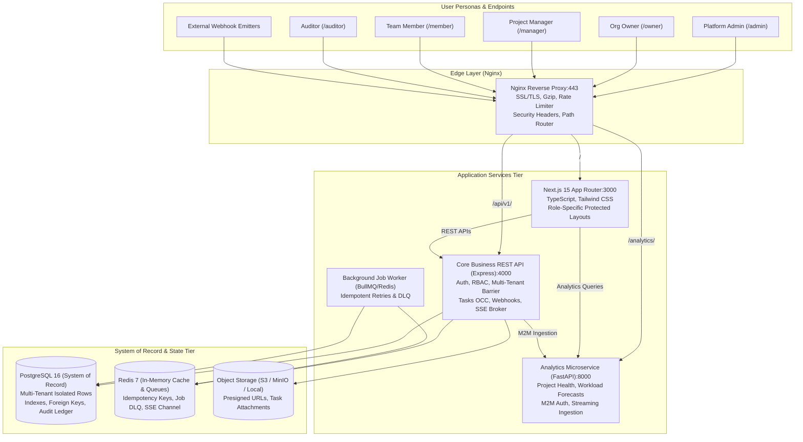
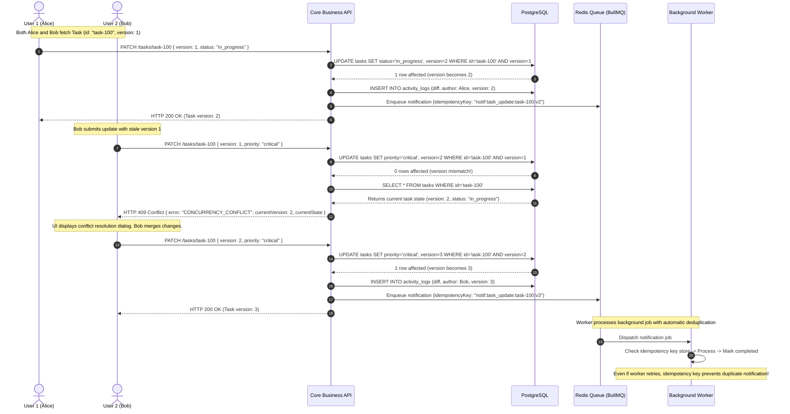

# WorkSphere Architecture & System Design Documentation

## 1. System Overview & Component Topology

WorkSphere is an enterprise-grade multi-tenant project planning, real-time collaboration, and workflow automation platform. The platform is designed around strict tenant boundary isolation, optimistic concurrency control for concurrent edits, event-driven background processing, and streaming analytics.

---

## 2. Domain Data-Flow & Concurrency Sequence Diagram

### Assessment 15 Capstone: Optimistic Concurrency Control (OCC)
When two users attempt to update the same task at nearly the same time, WorkSphere prevents silent overwrites using atomic version verification and preserves complete activity history:

---

## 3. Service Boundaries & Entity Ownership

| Entity | Owning Service | Authoritative Store | Responsibilities |
| :--- | :--- | :--- | :--- |
| **Organizations & Memberships** | Core API (`core-api`) | PostgreSQL (`organizations`, `organization_memberships`) | Tenant lifecycle, RBAC enforcement, user invitations |
| **Users & Credentials** | Core API (`core-api`) | PostgreSQL (`users`, `refresh_tokens`) | Password hashing (bcrypt), JWT generation, token family rotation |
| **Projects & Milestones** | Core API (`core-api`) | PostgreSQL (`projects`, `milestones`) | Scoped to tenant organization |
| **Tasks & Subtasks** | Core API (`core-api`) | PostgreSQL (`tasks`, `subtasks`) | Version column tracking, optimistic locking, real-time broadcasts |
| **Activity History** | Core API (`core-api`) | PostgreSQL (`activity_logs`) | Append-only immutable ledger of all field diffs |
| **Security Audits** | Core API (`core-api`) | PostgreSQL (`audit_events`) | Platform logins, role changes, blocked cross-tenant attempts |
| **Job Queue & Retries** | Background Worker | Redis (`task_queue`, `dlq_queue`) | Notification delivery, retries, idempotency deduplication |
| **Analytics & Health** | FastAPI Analytics | Python Engine / Memory | Streaming computation of throughput, cycle time, workload capacity |

---

## 4. Multi-Tenant Isolation Strategy

WorkSphere enforces tenant security at the HTTP middleware and database query layer:
1. **Request Identification**: Every incoming request to tenant resources must provide `x-organization-id` header or URL parameter.
2. **Session Verification**: The user's active memberships are checked against the requested organization. Platform admins can optionally access across tenants.
3. **Defense in Depth**: Every SQL query and repository method incorporates `WHERE organization_id = $tenantId`. A user from Organization A cannot view, query, or mutate records in Organization B (returns `403 Forbidden`).
4. **Automated Verification**: Verified by automated test suite `tests/tenant-isolation.test.ts`.

