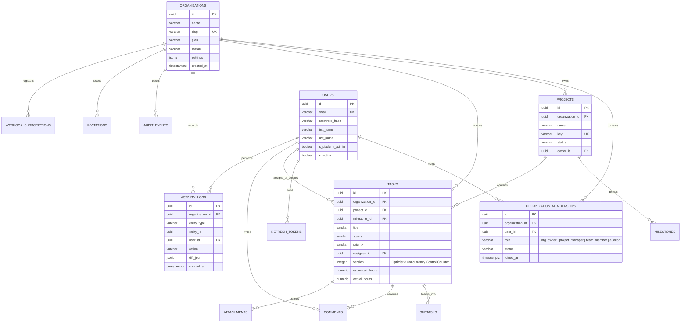

# WorkSphere Database Architecture & ER Documentation

## 1. Entity-Relationship Diagram (ERD)



---

## 2. Key Database Modeling Decisions

### A. Tenant Scoping (`organization_id`)
All core entities (`projects`, `tasks`, `milestones`, `comments`, `attachments`, `activity_logs`, `webhooks`) carry an explicit, non-nullable `organization_id` column indexed with foreign key cascades. This guarantees:
1. Fast tenant-filtered query access patterns.
2. Complete data isolation without relying exclusively on application memory filters.
3. Clean cross-tenant cascade cleanup if a tenant organization is purged or archived.

### B. Optimistic Concurrency Control Column (`version`)
The `tasks` table includes `version INTEGER NOT NULL DEFAULT 1`:
- Every update executes:
  ```sql
  UPDATE tasks
  SET title = $1, status = $2, version = version + 1, updated_at = NOW()
  WHERE id = $3 AND version = $4;
  ```
- If the version has already been incremented by a concurrent user transaction, 0 rows are updated. The application detects this and throws `ConcurrencyConflictError` (HTTP 409 Conflict), returning the server's current state.

### C. Immutable Activity History (`activity_logs`)
Instead of overwriting previous states without an audit trail, WorkSphere maintains an append-only `activity_logs` table recording:
- `diff_json`: Before and after values of modified fields.
- `user_id`: Actor responsible for the modification.
- `created_at`: Exact UTC timestamp.

---

## 3. Indexing Strategy & Query Optimization

| Table | Index Columns | Index Type | Purpose / Query Optimization |
| :--- | :--- | :--- | :--- |
| `organizations` | `(slug)` | B-Tree Unique | Subdomain & slug tenant lookups in O(1) time. |
| `organization_memberships` | `(organization_id, user_id)` | Composite Unique | Quick auth check to resolve tenant membership and role. |
| `tasks` | `(organization_id, project_id)` | Composite B-Tree | Accelerates project task boards. |
| `tasks` | `(organization_id, status)` | Composite B-Tree | Filters Kanban columns by status. |
| `tasks` | `(id, version)` | Composite B-Tree | High-speed atomic optimistic lock verification. |
| `tasks` | `(due_date)` | B-Tree | Overdue task identification queries. |
| `activity_logs` | `(organization_id, created_at DESC)` | Composite B-Tree | Activity timeline pagination for tenant audit stream. |
| `idempotency_keys` | `(scope, key)` | Composite Unique | Instant check for duplicate API requests and background jobs. |
| `refresh_tokens` | `(token_family)` | B-Tree | Instant family revocation upon refresh token reuse detection. |
